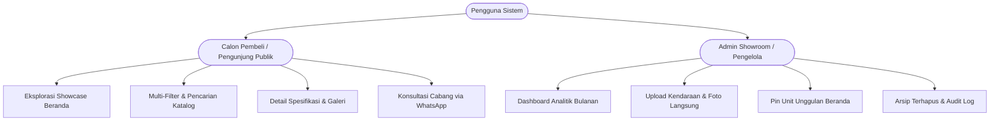
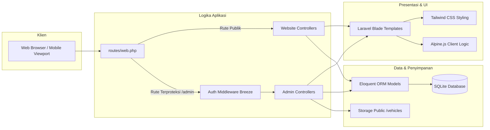
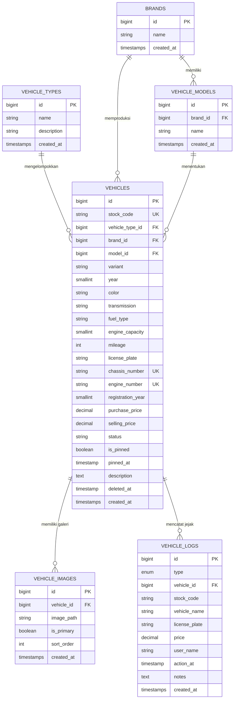

# Product Requirement Document (PRD)
## Platform Showroom & Inventaris Dealer: Suja Mobilindo

---

| Dokumen | Keterangan |
| :--- | :--- |
| **Nama Produk** | Suja Mobilindo Dealer Platform |
| **Versi Rilis** | v2.1 (Production Ready) |
| **Tanggal Pembuatan** | 7 Oktober 2026 |
| **Status Dokumen** | Disetujui (Approved) |
| **Target Pengguna** | Konsumen Publik (Pencari Mobil/Motor) & Manajemen Showroom (Admin/Staf) |
| **Arsitektur Teknis** | Monolithic Web Application (Laravel 12, Tailwind CSS, Alpine.js, SQLite) |

---

## 1. Eksekutif Ringkasan & Latar Belakang Bisnis

### 1.1 Latar Belakang
**Suja Mobilindo** adalah dealer kendaraan terkemuka yang menyediakan unit mobil dan motor bekas berkualitas tinggi dengan garansi resmi dan inspeksi fisik ketat. Untuk mendukung operasional multi-cabang (Garut & Bandung) serta memperluas jangkauan pasar secara digital, dibutuhkan sebuah platform terintegrasi yang:
1. Memfasilitasi calon pembeli dalam mencari, memfilter, dan menginspeksi katalog unit secara daring dengan antarmuka yang cepat, mewah, dan responsif.
2. Memudahkan pengelola showroom dalam mengontrol stok unit masuk/keluar, mengunggah galeri foto, memprioritaskan unit unggulan, serta memantau analitik performa penjualan bulanan.

### 1.2 Tujuan Produk (Product Goals)
- **Meningkatkan Konversi Penjualan**: Mempersingkat perjalanan konsumen dari penelusuran unit hingga komunikasi langsung ke tim sales melalui integrasi WhatsApp satu-klik.
- **Efisiensi Manajemen Stok**: Meniadakan pencatatan inventaris manual dengan sistem kode stok otomatis (`STK-XXXX`), pembuatan master data dinamis, dan pencatatan audit trail otomatis.
- **Integritas & Keamanan Data**: Menerapkan kebijakan *Soft Delete* agar data transaksi dan riwayat unit tidak hilang, serta pencegahan penghapusan pada unit yang telah berstatus *SOLD*.

---

## 2. Target Pengguna & Persona

### 2.1 Persona 1: Calon Pembeli (Customer Persona)
- **Karakteristik**: Pengunjung umum yang mengakses platform melalui perangkat mobile atau desktop.
- **Kebutuhan Utama**:
  - Menemukan kendaraan sesuai anggaran, tipe bensin, jenis transmisi, dan merek secara cepat.
  - Memverifikasi foto fisik dan spesifikasi lengkap kendaraan secara transparan.
  - Menghubungi showroom secara instan untuk verifikasi ketersediaan atau simulasi pembayaran.

### 2.2 Persona 2: Admin Showroom (Staff Persona)
- **Karakteristik**: Staf operasional showroom yang mengelola pergerakan unit mobil dan motor.
- **Kebutuhan Utama**:
  - Input unit baru dengan alur cepat tanpa harus membuat entitas master data secara manual.
  - Mengunggah banyak foto sekaligus langsung dari formulir pendaftaran.
  - Mengatur unit mana yang menjadi highlight di 3 posisi teratas beranda (*Pin Feature*).
  - Melacak unit yang masuk dan keluar lewat log pergerakan stok.

---

## 3. Arsitektur Sistem & Spesifikasi Teknologi

### 3.1 Diagram Arsitektur Aplikasi

### 3.2 Tech Stack Details
- **Backend Framework**: Laravel 12.x (PHP 8.2+)
- **Database Engine**: SQLite 3 (`database/database.sqlite`)
- **Autentikasi**: Laravel Breeze (Bcrypt Hashing, Session-Based Guard)
- **Frontend & Templating**: Blade Templating Engine
- **Styling**: Tailwind CSS (Desain Carita Luxury: Monokrom, Palet Zinc, Aksen Burgundy `#881337`)
- **Interaktivitas Client**: Alpine.js v3
- **Asset Bundler**: Vite 7.x
- **Infrastruktur Pendukung**: Native HTTPS Tunneling Handler (`AppServiceProvider`) untuk kompatibilitas Ngrok / reverse proxy.

---

## 4. Kebutuhan Fungsional (Functional Requirements)

### MODUL A: WEBSITE PUBLIK (CUSTOMER-FACING)

| ID Kebutuhan | Fitur | Deskripsi & Aturan Bisnis |
| :--- | :--- | :--- |
| **FR-PUB-01** | Landing Page (Beranda) | Menampilkan hero banner, formulir pencarian cepat (Brand & Tipe), 6 unit etalase terkini, profil keunggulan showroom, galeri fisik showroom, peta lokasi interaktif cabang Garut & Bandung, dan footer kontak. |
| **FR-PUB-02** | Prioritas Sematan (*Pinned Units*) | Beranda memprioritaskan hingga 3 unit berstatus `is_pinned = true` di posisi teratas showcase. Urutan sematan mengikuti `pinned_at` secara kronologis, dilanjutkan unit `AVAILABLE` terbaru. |
| **FR-PUB-03** | Penelusuran Katalog Kendaraan | Halaman `/vehicles` menyediakan penelusuran dengan parameter: kata kunci bebas, tipe kendaraan, merek, tahun, jenis transmisi, dan rentang harga (preset cepat atau batas min/max). |
| **FR-PUB-04** | Pengurutan & Paginasi Katalog | Mendukung sorting: Harga Terendah (`price_asc`), Harga Tertinggi (`price_desc`), Tahun Terbaru (`year_desc`), dan Terbaru Masuk (`latest`). Paginasi dibatasi 12 unit per halaman dengan mempertahankan query string URL. |
| **FR-PUB-05** | Filter Bar Simetris Mobile | Tata letak tombol "Atur Ulang Filter" dan "Terapkan Filter" di viewport mobile menggunakan grid 2-kolom berdampingan seimbang (50% : 50%) dengan tinggi dan tipografi identik. |
| **FR-PUB-06** | Detail & Galeri Unit | Halaman `/vehicles/{vehicle}` menampilkan spesifikasi detail lengkap, galeri multi-foto, foto sampul utama, status ketersediaan, serta tombol CTA WhatsApp marketing. |
| **FR-PUB-07** | Proteksi Status Non-Tersedia | Pengunjung umum dilarang mengakses halaman detail kendaraan yang tidak berstatus `AVAILABLE` (Sistem mengembalikan HTTP `404 Not Found`). |

---

### MODUL B: PANEL ADMIN (`/admin`)

| ID Kebutuhan | Fitur | Deskripsi & Aturan Bisnis |
| :--- | :--- | :--- |
| **FR-ADM-01** | Autentikasi Pengelola | Akses area `/admin` diwajibkan melewati middleware `auth`. Sesi diamankan dengan token CSRF dan pembatasan throttling percobaan login. |
| **FR-ADM-02** | Dashboard Analitik Bulanan | Menyediakan filter periode (Bulan & Tahun). Menghitung 4 metrik KPI: Motor Masuk, Mobil Masuk, Motor Terjual, Mobil Terjual (termasuk unit berstatus `SOLD` dan unit soft-deleted pada bulan tersebut). Menampilkan pratinjau 6 unit terbaru. |
| **FR-ADM-03** | Penomoran Kode Stok Otomatis | Sistem secara otomatis mengusulkan kode stok berturut-turut dengan pola `STK-XXXX` (mengambil nomor tertinggi yang pernah tercatat + 1, dengan padding 4 digit). |
| **FR-ADM-04** | Pendaftaran Unit Baru Cerdas | Admin dapat menginput Nama Tipe, Brand, dan Model secara teks bebas. Sistem secara otomatis mencari kecocokan *case-insensitive*; jika belum ada, record master data baru dibuat secara otomatis di dalam `DB::transaction`. |
| **FR-ADM-05** | Unggah Foto Langsung di Create (Poin 4) | Form pendaftaran kendaraan menyediakan Poin 4 dengan area dropzone untuk unggah berkas gambar (`.jpg, .jpeg, .png, .webp`, maks. 10MB per berkas). Foto pertama yang dipilih otomatis ditetapkan sebagai `is_primary = true`. |
| **FR-ADM-06** | Pratinjau Foto Interaktif | Formulir input menggunakan Alpine.js untuk menampilkan thumbnail pratinjau, nama berkas, ukuran berkas, dan penanda foto utama secara real-time sebelum data disubmit. |
| **FR-ADM-07** | Manajemen Galeri Foto Detail | Pada halaman detail unit admin, staf dapat menambah foto tambahan, menghapus foto, dan menetapkan ulang foto mana yang menjadi foto sampul utama (*Primary Image*). |
| **FR-ADM-08** | Mekanisme Fallback Foto Sampul | Jika foto sampul utama dihapus dari galeri, sistem secara otomatis menetapkan foto urutan berikutnya yang tersedia sebagai foto sampul utama baru. |
| **FR-ADM-09** | Kuota Pin Beranda | Admin dapat menyematkan unit ke beranda dengan batas maksimal **3 unit**. Tombol pin divalidasi di backend & frontend agar tidak melampaui kuota. |
| **FR-ADM-10** | Kebijakan Proteksi Hapus Unit | Unit yang telah berstatus `SOLD` diblokir dari aksi penghapusan untuk menjaga konsistensi dan integritas riwayat laporan keuangan. |
| **FR-ADM-11** | Manajemen Arsip Terhapus (*Trash*) | Halaman `/admin/vehicles/trash` menampilkan unit yang di-*soft delete*. Dilengkapi fitur filter tipe kendaraan (Mobil/Motor), statistik terhapus, fitur **Pulihkan (Restore)**, dan **Hapus Permanen (Force Delete)**. |
| **FR-ADM-12** | Pencatatan Audit Trail (*Vehicle Logs*) | Sistem otomatis mencatat log ke tabel `vehicle_logs`: Tipe `IN` saat kendaraan baru disimpan atau dipulihkan, dan tipe `OUT` saat kendaraan dihapus. |

---

## 5. Model Data & Kamus Basis Data

### Kamus Nilai Status Kendaraan (`vehicles.status`):
- `AVAILABLE`: Unit siap dipasarkan di showroom dan tampil di website publik.
- `RESERVED`: Unit sedang di-booking / tanda jadi oleh calon pembeli.
- `SOLD`: Unit telah terjual lunas (dilindungi dari penghapusan).
- `SERVICE`: Unit dalam inspeksi bengkel / salon fisik.
- `INACTIVE`: Unit dinonaktifkan dari katalog publik.

---

## 6. Kebutuhan Non-Fungsional (Non-Functional Requirements)

### 6.1 Keamanan (Security)
- Seluruh formulir menggunakan proteksi **CSRF Token** bawaan Laravel.
- Pencegahan **SQL Injection** menggunakan parameter binding Eloquent ORM.
- Pencegahan **Mass-Assignment Vulnerability** melalui deklarasi eksplisit atribut `$fillable` pada setiap Model Eloquent.
- Autentikasi kata sandi menggunakan enkripsi **Bcrypt Hash**.
- Validasi ketat tipe berkas gambar (MIME types: `jpg, jpeg, png, webp`) dengan limitasi ukuran maksimal berkas 10MB.

### 6.2 Performa & Skalabilitas (Performance)
- Seluruh kueri relasi pada controller menerapkan teknik **Eager Loading** (`with(['brand', 'model', 'vehicleType', 'primaryImage'])`) untuk mengeliminasi problem `N+1 Query`.
- Indeks basis data dipasang pada kolom kueri frekuensi tinggi: `status`, `year`, `selling_price`, `license_plate`.
- Penanganan aset modern menggunakan **Vite** untuk *code splitting* dan kompilasi CSS yang teroptimasi.

### 6.3 Kompatibilitas & Tampilan Responsif (Usability & Responsiveness)
- Antarmuka mengusung filosofi **Mobile-First**: seluruh grid katalog, formulir filter, tombol aksi, dan drawer navigasi dapat dioperasikan secara ergonomis pada berbagai resolusi layar (Mobile: 360px–430px, Tablet: 768px, Desktop: 1024px+).
- Estetika visual dirancang dengan tema monokrom premium (*Carita Luxury Concept*) dipadukan dengan aksen burgundy/rose (`#881337`) dan tipografi modern (Plus Jakarta Sans & JetBrains Mono).

---

## 7. Penanganan Kasus Batas (Edge Cases & Business Rules)

1. **Batas Maksimal Unit yang Di-Pin**:
   - Jika admin mencoba me-pin unit ke-4 saat kuota 3 unit telah terpakai, sistem akan memblokir aksi dan memunculkan pesan peringatan di UI: *"Maksimal 3 unit yang dapat di-pin di beranda. Lepas pin salah satu unit terlebih dahulu."*
2. **Unit Terhapus yang Berstatus Pinned**:
   - Jika unit yang sedang di-pin dihapus oleh admin, sistem secara otomatis mencabut status pin (`is_pinned = false`, `pinned_at = null`) sebelum mengeksekusi *soft delete* agar kuota pin unit di beranda tidak terkunci.
3. **Pemberian Cover Otomatis Saat Penghapusan Foto**:
   - Jika foto yang ditandai sebagai `is_primary` dihapus oleh staf, sistem secara otomatis menaikkan status foto berikutnya menjadi foto utama baru, sehingga katalog publik tidak mengalami kekosongan thumbnail.
4. **Validasi Unik Nomor Rangka & Mesin Saat Edit**:
   - Validasi keunikan `chassis_number` dan `engine_number` secara otomatis mengecualikan ID unit kendaraan saat ini agar tidak terjadi galat duplikasi saat menyimpan perubahan data.

---

## 8. Roadmap Pengembangan Selanjutnya (Future Enhancements)

- **Fase 3.0**: Integrasi sistem simulasi kredit interaktif dengan kalkulator angsuran per bulan berdasarkan DP.
- **Fase 3.1**: Modul Multi-Cabang Berbasis Akun (Admin Garut vs Admin Bandung).
- **Fase 3.2**: Fitur *Watermarking* otomatis pada foto unit kendaraan saat diunggah ke server.
- **Fase 3.3**: Cetak surat jalan dan SPK (Surat Pemesanan Kendaraan) dalam format PDF langsung dari panel admin.
